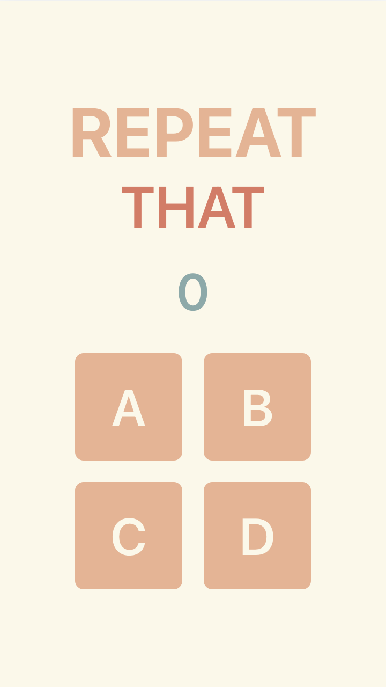

<div align="center">

# Repeat-That

**A React Native memory game inspired by Simon.**

Tiles flash on screen in a growing sequence. Watch it, then repeat it from
memory — one extra tile every round, until you slip.

[](LICENSE) [](https://reactnative.dev/) [](https://www.typescriptlang.org/) [](https://expo.dev/)

</div>

---

## Screenshots

<table>
  <tr>
    <td width="33%"></td>
    <td width="33%"></td>
    <td width="33%"></td>
  </tr>
</table>

## Features

- **Classic Simon gameplay** — watch the sequence, then repeat it from memory.
- **Progressive difficulty** — every cleared round adds one more tile.
- **Persistent best score** — your record is saved on the device.
- **Cross-platform** — iOS, Android, and web from a single codebase.

## Tech Stack

| Area           | Tools                                                                                       |
| -------------- | ------------------------------------------------------------------------------------------- |
| **Framework**  | [Expo](https://expo.dev/) SDK 57 · [React Native](https://reactnative.dev/) 0.86             |
| **Language**   | [TypeScript](https://www.typescriptlang.org/) 6.0                                            |
| **UI**         | [React](https://react.dev/) 19.2 · [react-native-svg](https://github.com/software-mansion/react-native-svg) |
| **Storage**    | [AsyncStorage](https://react-native-async-storage.github.io/async-storage/)                 |
| **Lint/Format**| [Biome](https://biomejs.dev/) 2.5                                                            |

## Project Structure

```
src/
├── main.tsx              # Entry point, referenced by "main" in package.json
├── App.tsx               # Providers (safe area, status bar)
├── navigation/
│   ├── Router.tsx        # Screen switch driven by the current route
│   └── routes.ts         # Route union — params live on the route that needs them
├── screens/              # One file per screen
├── components/           # Reusable views, with SVG icons under icons/
├── hooks/                # useSimonGame (game loop), useBestScore (persistence)
├── lib/                  # Framework-free helpers: sequence logic, storage
└── constants/            # Colors and gameplay tuning values
```

The `android/` and `ios/` directories are not tracked — they are generated
output. Run `npm run prebuild` when you need them for a native build.

## Getting Started

These instructions will get you a copy of the project up and running on your
local machine for development purposes.

### Requirements

To install and run this project you need:

- [Node.js](https://nodejs.org/) 20 or newer
- [git](https://git-scm.com/downloads) (only to clone this repository)
- [Expo Go](https://expo.dev/go) on your phone, or an Android emulator or
  iOS simulator

### Installation

To set up everything on your local machine, follow these steps:

1. Clone this repo and then change directory to the `repeat-that` folder:

```bash
git clone https://github.com/kaushalmeena/repeat-that.git
cd repeat-that
```

2. Install project dependencies using npm:

```bash
npm install
```

### Running

Start the dev server and pick a target from the terminal menu:

```bash
npm start
```

Or launch straight into one platform:

```bash
npm run start:android
```

```bash
npm run start:ios
```

```bash
npm run start:web
```

### Scripts

| Script              | What it does                                     |
| ------------------- | ------------------------------------------------ |
| `npm start`         | Start the Expo dev server                        |
| `npm run typecheck` | Type check with `tsc --noEmit`                   |
| `npm run lint`      | Lint and check formatting with Biome             |
| `npm run lint:fix`  | Apply Biome's safe fixes                         |
| `npm run format`    | Format the codebase                              |
| `npm run prebuild`  | Regenerate the native `android/` and `ios/` dirs |

## Contributing

Contributions are welcome! If you find a bug or have a feature request, please
[open an issue](https://github.com/kaushalmeena/repeat-that/issues/new/choose)
first to discuss it. For code changes, fork the repository, create a branch,
and open a pull request.

Please make sure `npm run typecheck` and `npm run lint` both pass before
opening a pull request.

## License

This project is licensed under the MIT License — see the [LICENSE](LICENSE)
file for details.
