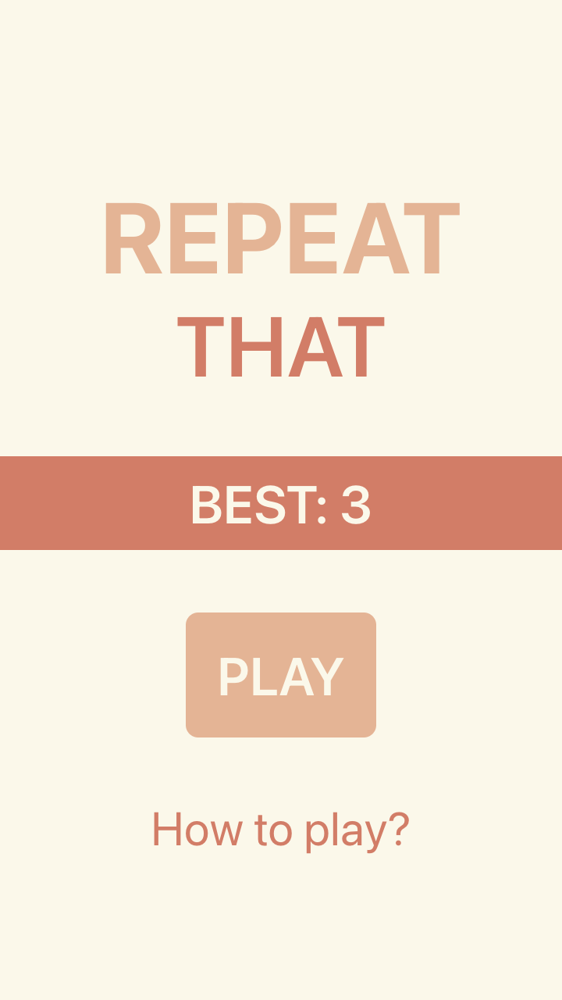
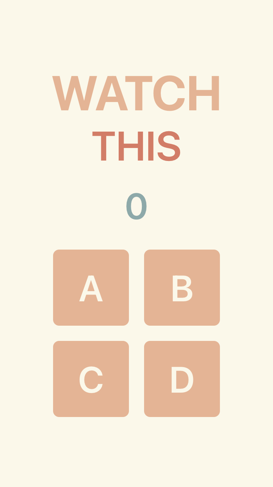
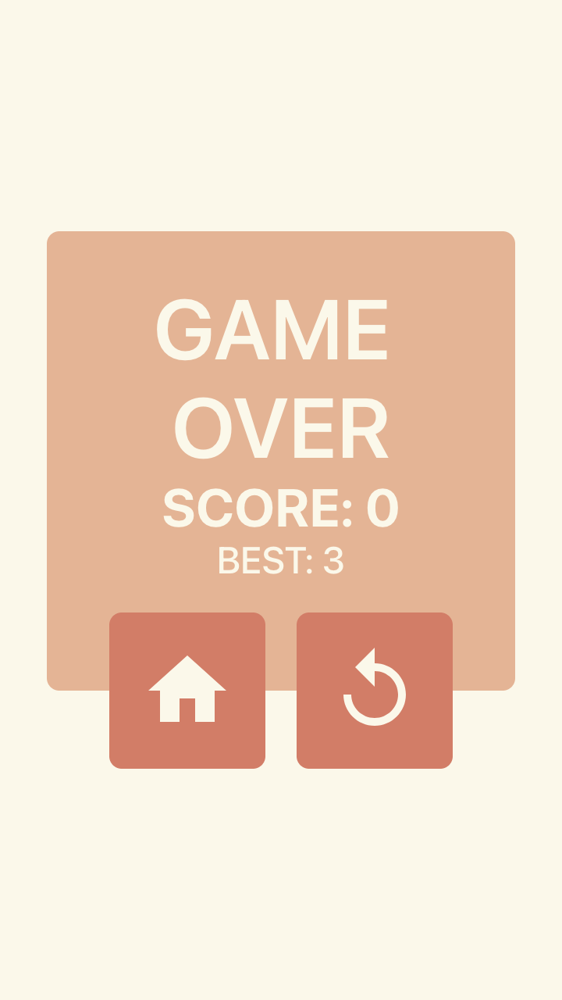

<div align="center">

# Repeat-That

[](LICENSE) [](https://expo.dev/) [](https://reactnative.dev/) [](https://www.typescriptlang.org/)

**A React Native memory game inspired by Simon.**

Colored tiles flash on screen, each with its own tone. Watch the sequence, then
tap it back from memory. Every round is a new sequence, one tile longer and a
little quicker, until you slip.

</div>

---

## Screenshots

<table>
  <tr>
    <td width="33%"></td>
    <td width="33%"></td>
    <td width="33%"></td>
  </tr>
</table>

## Features

- **Classic Simon gameplay** — watch the sequence, then repeat it from memory.
- **Four distinct tiles** — each with its own color and its own musical tone,
  and a letter so the game still works without color vision.
- **A fresh sequence every round** — rounds are redrawn rather than extended, so
  a good memory for the last round is no substitute for watching this one.
- **Progressive difficulty** — each round adds a tile *and* closes the gap
  between flashes, down to a floor.
- **Immediate feedback** — a wrong tap ends the run there and then. Every tap is
  heard and felt: tiles play their own note, buttons get a quieter click.
- **Persistent best score** — your record is saved on the device, and a new one
  is called out on the game over screen.
- **Cross-platform** — iOS, Android, and web from a single codebase.

## Tech Stack

| Area           | Tools                                                                                       |
| -------------- | ------------------------------------------------------------------------------------------- |
| **Framework**  | [Expo](https://expo.dev/) SDK 57 · [React Native](https://reactnative.dev/) 0.86             |
| **Routing**    | [Expo Router](https://docs.expo.dev/router/introduction/) 57 (file-based)                     |
| **Language**   | [TypeScript](https://www.typescriptlang.org/) 6.0                                            |
| **UI**         | [React](https://react.dev/) 19.2 · [react-native-svg](https://github.com/software-mansion/react-native-svg) |
| **Feedback**   | [expo-audio](https://docs.expo.dev/versions/latest/sdk/audio/) · [expo-haptics](https://docs.expo.dev/versions/latest/sdk/haptics/) |
| **Storage**    | [AsyncStorage](https://react-native-async-storage.github.io/async-storage/)                 |
| **Testing**    | [Jest](https://jestjs.io/) 29 · [jest-expo](https://docs.expo.dev/develop/unit-testing/)     |
| **Lint/Format**| [Biome](https://biomejs.dev/) 2.5                                                            |

## Getting Started

These instructions will get you a copy of the project up and running on your
local machine for development purposes.

### Requirements

To install and run this project you need:

- [Node.js](https://nodejs.org/) 20 or newer
- [git](https://git-scm.com/downloads) (only to clone this repository)
- [Expo Go](https://expo.dev/go) on your phone, or an Android emulator or
  iOS simulator

### Installation

To set up everything on your local machine, follow these steps:

1. Clone this repo and then change directory to the `repeat-that` folder:

```bash
git clone https://github.com/kaushalmeena/repeat-that.git
cd repeat-that
```

2. Install project dependencies using npm:

```bash
npm install
```

### Running

Start the dev server and pick a target from the terminal menu:

```bash
npm start
```

Or launch straight into one platform:

```bash
npm run start:android
```

```bash
npm run start:ios
```

```bash
npm run start:web
```

### Scripts

| Script              | What it does                                     |
| ------------------- | ------------------------------------------------ |
| `npm start`         | Start the Expo dev server                        |
| `npm test`          | Run the unit tests with Jest                     |
| `npm run check`     | Lint, typecheck and test — the CI gate           |
| `npm run lint:fix`  | Apply Biome's safe fixes                         |
| `npm run prebuild`  | Regenerate the native `android/` and `ios/` dirs |

## Contributing

Contributions are welcome! If you find a bug or have a feature request, please
[open an issue](https://github.com/kaushalmeena/repeat-that/issues/new/choose)
first to discuss it. For code changes, fork the repository, create a branch,
and open a pull request.

Please make sure `npm run check` passes
before opening a pull request.

## License

This project is licensed under the MIT License — see the [LICENSE](LICENSE)
file for details.
